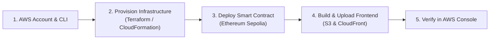

# 🚀 CryptoVoyage: Complete AWS Cloud Deployment Guide

This guide walks you through deploying the **CryptoVoyage** platform from local testing to **live production on Amazon Web Services (AWS)**.

---

## 📑 Deployment Overview



---

## 🛠️ Step 1: Prerequisites & Account Configuration

### 1.1 AWS Credentials
You need an active AWS Account. Configure your credentials on your computer:
```bash
aws configure
```
You will be prompted for:
- **AWS Access Key ID**: `AKIA...`
- **AWS Secret Access Key**: `...`
- **Default region name**: `us-east-1` (or your preferred region)
- **Default output format**: `json`

Verify your identity:
```bash
aws sts get-caller-identity
```

### 1.2 Install Terraform (If using Terraform)
If Terraform is not installed on Linux:
```bash
sudo yum install -y yum-utils
sudo yum-config-manager --add-repo https://rpm.releases.hashicorp.com/AmazonLinux/hashicorp.repo
sudo yum -y install terraform
```
*(On Ubuntu/Debian: `sudo apt-get install terraform`)*

---

## 🏗️ Step 2: Provision Cloud Infrastructure with Terraform (Recommended)

All 12 AWS services are defined as declarative code inside `infrastructure/terraform/`.

### 2.1 Navigate to the Terraform Directory
```bash
cd "/home/govind/Documents/Projects/Cloud Project/infrastructure/terraform"
```

### 2.2 Initialize Terraform Providers
```bash
terraform init
```
This downloads the official AWS provider and prepares the dependency graph.

### 2.3 Review the Execution Plan
```bash
terraform plan
```
This validates all resource definitions:
- Amazon Route 53 & CloudFront Distribution
- Amazon Cognito User Pool & App Client
- Amazon API Gateway & Cognito Authorizers
- 11 AWS Lambda Microservices
- AWS Step Functions Saga State Machine
- Amazon DynamoDB `TravelCarts` Table with TTL
- Amazon RDS PostgreSQL Multi-AZ Instance
- Amazon ElastiCache Redis Cluster
- Amazon EC2 Sepolia Blockchain Node
- AWS KMS Customer Managed Key
- Amazon S3 Buckets (Frontend SPA & Invoices)
- Amazon CloudWatch Log Groups & Alarms

### 2.4 Apply and Deploy
```bash
terraform apply -auto-approve
```
When deployment finishes (~10–15 minutes for RDS/ElastiCache provisioning), Terraform outputs all critical endpoints:
```
Outputs:
api_gateway_url         = "https://a1b2c3d4.execute-api.us-east-1.amazonaws.com/prod"
cloudfront_domain_name  = "d123456abcdef8.cloudfront.net"
cognito_user_pool_id    = "us-east-1_abcdef123"
cognito_client_id       = "1a2b3c4d5e6f7g8h9i0"
s3_invoices_bucket      = "cryptovoyage-invoices-prod"
step_functions_saga_arn = "arn:aws:states:us-east-1:...:stateMachine:cryptovoyage-booking-saga"
```

> **Save these output values!** You will connect them to the frontend in Step 4.

---

## 📜 Step 3: Deploy the Smart Contract to Sepolia

Deploy the Solidity contract (`contracts/TravelBookingEscrow.sol`) to Ethereum Sepolia using **Remix IDE** (zero installation required):

1. Open [remix.ethereum.org](https://remix.ethereum.org).
2. Create a new file in Remix: `TravelBookingEscrow.sol`.
3. Copy and paste the contents of [`contracts/TravelBookingEscrow.sol`](../contracts/TravelBookingEscrow.sol).
4. In the **Solidity Compiler** tab on the left:
   - Select compiler version: `0.8.20` or higher.
   - Click **Compile TravelBookingEscrow.sol**.
5. In the **Deploy & Run Transactions** tab:
   - Set **ENVIRONMENT** to **"Injected Provider - MetaMask"**.
   - Make sure your MetaMask is connected to **Ethereum Sepolia Testnet**.
   - Under **Deploy**, provide the constructor argument `_oracleVerifier`:  
     *(You can enter your own MetaMask address or the EC2 node verifier address)*.
   - Click **Deploy** and confirm the transaction in MetaMask.
6. Once mined, copy the **Deployed Contract Address** (e.g. `0x35b9A4753f81c4DEa96bdeff3a44fdE5E6D4b752`).

---

## 🌐 Step 4: Build & Upload the Web Application to S3 + CloudFront

### 4.1 Update Frontend Environment Variables
In `frontend/`, create `.env.production` with the values from your Terraform outputs:
```env
VITE_API_BASE_URL=https://<YOUR_API_GATEWAY_ID>.execute-api.us-east-1.amazonaws.com/prod
VITE_COGNITO_USER_POOL_ID=<YOUR_COGNITO_USER_POOL_ID>
VITE_COGNITO_CLIENT_ID=<YOUR_COGNITO_CLIENT_ID>
VITE_ESCROW_CONTRACT_ADDRESS=<YOUR_DEPLOYED_SEPOLIA_CONTRACT_ADDRESS>
```

### 4.2 Build the Static Production Bundle
```bash
cd "/home/govind/Documents/Projects/Cloud Project/frontend"
npm run build
```
This produces an optimized single-page application in `frontend/dist/`.

### 4.3 Upload to Amazon S3
```bash
aws s3 sync dist/ s3://cryptovoyage-frontend-spa-prod --delete
```

### 4.4 Invalidate CloudFront Edge Cache
```bash
aws cloudfront create-invalidation   --distribution-id <YOUR_CLOUDFRONT_DISTRIBUTION_ID>   --paths "/*"
```

Your web application is now live globally at `https://<YOUR_CLOUDFRONT_DOMAIN>.cloudfront.net`!

---

## 🔍 Step 5: Verify Everything in the AWS Management Console

Once deployed, you can verify each service directly in the AWS Console:

1. **AWS Step Functions**:
   - Open the **AWS Step Functions Console**.
   - Select `cryptovoyage-booking-saga`.
   - Initiate a booking from your live CloudFront website.
   - You will see the visual execution graph run in real-time with green boxes for each task:
     `ReserveHotelTask` ➔ `BookCabTask` ➔ `CalculateFeesTask` ➔ `VerifyCryptoPaymentTask` ➔ `ConfirmBookingTask` ➔ `GenerateInvoiceTask`.
2. **Amazon DynamoDB**:
   - Open **DynamoDB Console** ➔ **Tables** ➔ `cryptovoyage-travel-carts`.
   - Add an item to your cart on the website; inspect the item in DynamoDB to see the sub-millisecond write and the 1-hour Unix TTL timestamp.
3. **Amazon RDS**:
   - Connect via `psql` or Database GUI using the RDS endpoint from Terraform outputs.
   - Query `SELECT * FROM bookings;` to see confirmed transactions.
4. **Amazon S3**:
   - Open **S3 Console** ➔ `cryptovoyage-invoices-prod`.
   - Inspect the generated booking invoices with SSE-KMS hardware encryption.
5. **Amazon CloudWatch**:
   - Open **CloudWatch Console** ➔ **Dashboards** ➔ `cryptovoyage-Production-Overview`.
   - View live charts for `SuccessfulBookings`, `FailedBookings`, and `SagaRollbacks`.

---

## 🧹 Tearing Down Resources (Cost Control)

When your presentation, evaluation, or grading is finished, you can remove all provisioned cloud resources with a single command to avoid unnecessary AWS bills:

```bash
cd infrastructure/terraform
terraform destroy -auto-approve
```
